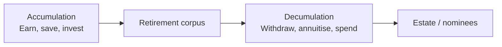
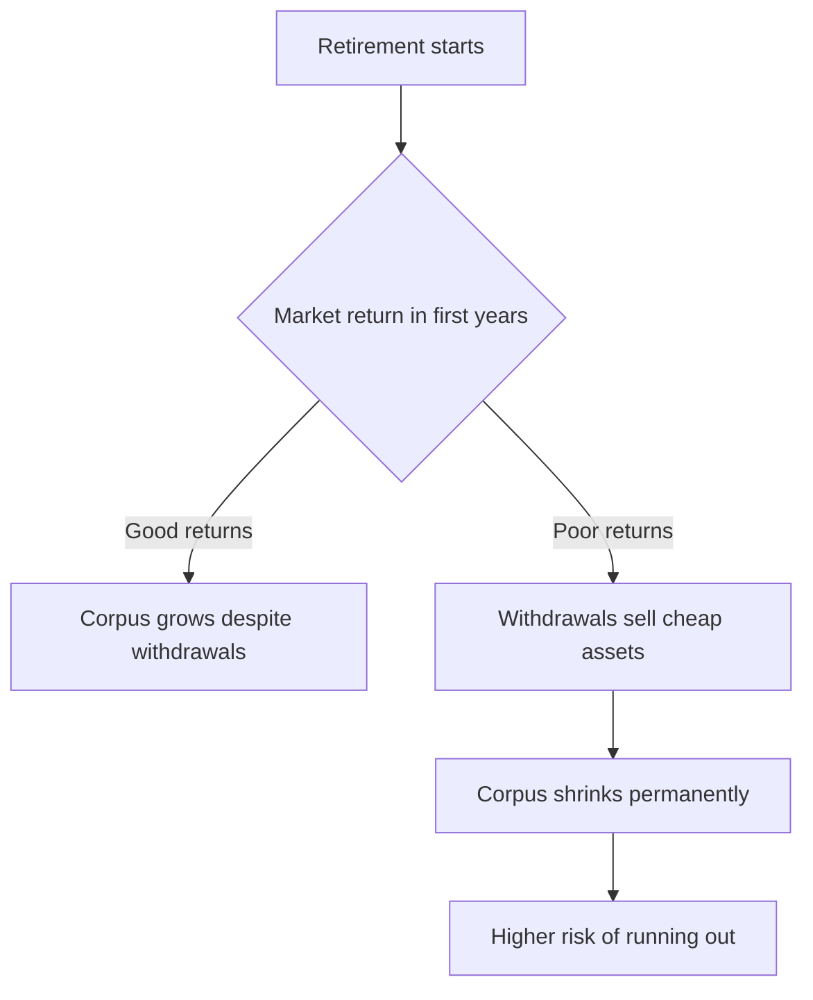
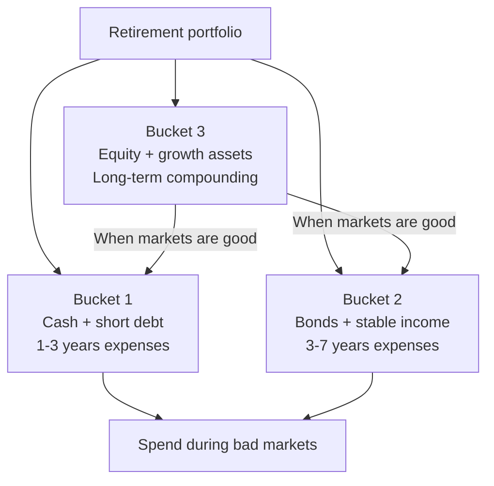

# Retirement Planning Basics

## What It Is

**Retirement planning** is the process of converting human capital (your salary) into financial capital (a portfolio), then converting that portfolio into reliable cash flow after you stop working.

It has two distinct phases:



| Phase | Goal | Main Risk |
|---|---|---|
| **Accumulation** | Grow the corpus | Not saving enough, poor returns, high fees |
| **Decumulation** | Make the corpus last | Inflation, longevity, bad withdrawal sequence |

The accumulation phase is about **maximising contributions and compounding**. The decumulation phase is about **managing withdrawals and risk**. They are different problems.

---

## The Core Math

### Step 1: Inflate today's expenses

```
Future annual expense =
    Current annual expense × (1 + inflation)^years
```

Example: ₹50,000/month today, 20 years to retirement, 6% inflation:

```
₹50,000 × (1.06)^20 = ₹1,60,357/month
Annual expense    = ₹19,24,281
```

Your retirement lifestyle costs more than today's lifestyle because prices rise.

### Step 2: Convert expenses into a corpus

```
Corpus = Annual expense at retirement / withdrawal rate
```

Using a conservative 4% withdrawal rate:

```
₹19,24,281 / 0.04 = ₹4.81 crore
```

That is the corpus needed to fund ₹1.60 lakh/month (in future rupees) with a 4% initial withdrawal rate.

### Step 3: Check the real return

```
Real return = (1 + nominal return) / (1 + inflation) − 1
```

Example: 8% nominal return, 6% inflation:

```
(1.08 / 1.06) − 1 = 1.89% real return
```

A portfolio earning 8% while inflation is 6% grows purchasing power by only about 1.9% per year. Retirement math is always in **real** terms.

---

## Withdrawal Rates

The **withdrawal rate** is the percentage of the corpus you withdraw in the first year of retirement.

| Withdrawal Rate | Corpus Multiple | Interpretation |
|---|---|---|
| 3% | 33× annual expenses | Very conservative, long retirement |
| 3.5% | 29× | Conservative for India |
| 4% | 25× | Common rule of thumb |
| 5% | 20× | Higher risk of running out |
| 6%+ | 17× or less | Aggressive; needs flexibility |

```
Corpus multiple = 1 / withdrawal rate
```

The 4% rule comes from US historical data. It is a starting point, not a guarantee. India-specific factors matter:

- Inflation is often higher
- Equity returns are volatile
- Medical costs can rise faster than general inflation
- Retirement may last 30+ years
- Taxes and annuity pricing reduce spendable income

Use 3.5–4% for a conservative plan, and stress-test lower returns and higher inflation.

---

## The Risks That Matter

| Risk | What It Means | Mitigation |
|---|---|---|
| **Inflation risk** | Expenses rise faster than income | Equity, inflation-linked instruments, realistic inflation assumptions |
| **Longevity risk** | You live longer than the corpus | Annuity, conservative withdrawal rate, longevity hedge |
| **Sequence-of-returns risk** | Bad returns early in retirement permanently damage the corpus | Cash/bond bucket, flexible withdrawals, avoid forced selling |
| **Health risk** | Medical costs spike | Health insurance, emergency fund, dedicated medical reserve |
| **Concentration risk** | One asset or employer dominates | Diversification, avoid company stock overload |
| **Policy/tax risk** | Rules and tax treatment change | Diversify across wrappers, review annually |
| **Behavioural risk** | Panic selling or overspending | Written plan, automatic contributions, rebalancing rules |

### Sequence-of-returns risk



Two retirees can have the same average return but very different outcomes if the bad years arrive early. This is why a retirement portfolio needs a **cash and debt buffer**, not just long-run growth assets.

---

## Defined Benefit vs Defined Contribution

Pension schemes differ in who bears the investment risk.

| Type | What Is Defined | Who Bears Risk | Examples |
|---|---|---|---|
| **Defined benefit (DB)** | Monthly pension | Employer/government | EPS, traditional government pension |
| **Defined contribution (DC)** | Contribution amount | Employee | NPS, EPF, PPF |
| **Hybrid** | Assured payout plus a fund | Shared | UPS (assured payout within NPS architecture) |
| **Guaranteed pension** | Minimum payout | Government/insurer | APY, annuity |

DB schemes promise an outcome. DC schemes promise an input. A DC scheme can produce a great pension or a disappointing one depending on contributions, returns, costs, and exit choices. APY and annuities guarantee a payout but depend on contributions, pricing, and scheme rules.

---

## Building the Retirement Portfolio

A common structure is the **three-bucket approach**:



| Bucket | Purpose | Typical Holdings |
|---|---|---|
| **Short-term** | Spending and emergencies | Savings account, liquid funds, short-duration debt |
| **Medium-term** | Stability and refilling | Bonds, debt funds, SCSS, fixed deposits |
| **Long-term** | Growth and inflation protection | Equity, NPS equity allocation, real assets |

### Glide path

As retirement approaches, reduce equity and increase stable income. But do not go to 100% cash. You still need growth to fight inflation over a 25–30 year retirement.

| Age / Stage | Equity | Debt / Stable | Notes |
|---|---|---|---|
| 20s–30s | 70–90% | 10–30% | High human capital, long horizon |
| 40s | 60–75% | 25–40% | Start building the stable bucket |
| 50s | 40–60% | 40–60% | De-risk gradually, avoid abrupt shifts |
| Near retirement | 30–50% | 50–70% | 2–3 years of expenses in cash/debt |
| In retirement | 20–40% | 60–80% | Keep growth for inflation; hold liquidity |

---

## Accumulation vs Decumulation

| Dimension | Accumulation | Decumulation |
|---|---|---|
| Cash flow | Salary in, investments out | Portfolio in, spending out |
| Main objective | Maximise growth | Maximise sustainable income |
| Time horizon | Long | Long, but withdrawals start now |
| Key risk | Under-saving | Sequence risk, longevity, inflation |
| Tax focus | Deductions and deferral | Withdrawal order and tax-efficient income |
| Behaviour | Automate contributions | Follow a written withdrawal policy |

```
Accumulation rule: automate contributions and ignore short-term noise.
Decumulation rule: never be a forced seller in a bad market.
```

---

## Programming Analogy

```
Retirement corpus = a long-running service with a fixed memory budget.

Contributions = requests adding to the buffer.
Returns = throughput growth.
Inflation = a slow memory leak that increases required capacity.
Withdrawals = steady traffic draining the buffer.
Sequence risk = a burst of traffic at the worst possible time.
Annuity = a guaranteed minimum capacity contract.
Rebalancing = autoscaling between fast and slow resource pools.
```

The goal is not maximum peak capacity. It is **reliable capacity under stress**.

---

## Common Mistakes

- **Using today's expenses without inflation.** A ₹50,000/month lifestyle can cost ₹1.6 lakh/month in 20 years.
- **Assuming a fixed 4% rule is safe.** Stress-test lower returns, higher inflation, and early bad years.
- **Ignoring longevity.** A 60-year-old may need 30+ years of income.
- **Keeping everything in safe deposits.** Inflation silently erodes purchasing power.
- **Going 100% equity in retirement.** Sequence risk can force selling at the worst time.
- **Forgetting health costs.** Keep separate health insurance and a medical reserve.
- **No written withdrawal policy.** Decisions made in panic are usually bad decisions.
- **Not reviewing the plan.** Inflation, tax rules, and personal circumstances change.

---

## Interview Notes

- **Product: "Design a retirement planner."** Model contributions, inflation, expected returns, fees, taxes, and withdrawal scenarios. Show a range of outcomes, not one deterministic number.
- **Data: "How would you model retirement corpus?"** Use a cash-flow simulation with annual contributions, stochastic returns, inflation paths, and mortality assumptions. Output a distribution of terminal wealth and failure probability.
- **System Design: "Build a retirement income engine."** Represent accounts as buckets with different liquidity, tax treatment, and rules. Generate withdrawal schedules that satisfy spending while minimizing taxes and preserving the corpus.
- **Risk: "What is sequence-of-returns risk?"** Early withdrawals during a drawdown permanently reduce the corpus because units are sold at low prices. Mitigate with a cash/debt buffer and flexible spending.

---

## Revision Summary

| Concept | Definition |
|---|---|
| Accumulation | Phase of saving and investing before retirement |
| Decumulation | Phase of withdrawing and spending in retirement |
| Real return | Return after inflation |
| Withdrawal rate | First-year withdrawal as a percentage of corpus |
| Corpus multiple | 1 / withdrawal rate (e.g., 4% = 25×) |
| Sequence risk | Risk from the order of returns during withdrawals |
| Longevity risk | Risk of outliving the corpus |
| Three-bucket strategy | Cash, debt, and growth buckets for spending and stability |
| Glide path | Gradual shift from equity to stable assets near retirement |

- Plan in real (after-inflation) terms
- Use a conservative withdrawal rate and stress-test it
- Keep 2–3 years of expenses liquid
- Do not be a forced seller in a bad market
- Annuity can hedge longevity, but it has a cost

---

← [↑ Phase 9](README.md) • [↑ Finance](../README.md) • [01-nps](01-nps.md) →
