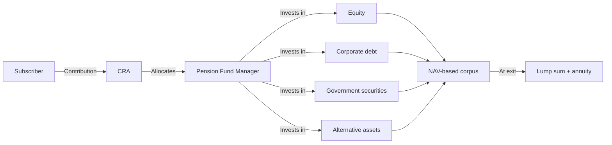

# National Pension System (NPS)

## What It Is

The **National Pension System (NPS)** is a voluntary, market-linked, defined-contribution pension scheme regulated by the **Pension Fund Regulatory and Development Authority (PFRDA)**.

You contribute during your working years. The money is invested in pension funds. At exit, part of the corpus can be withdrawn and part must be used to buy an annuity that pays a pension.



NPS returns are **not guaranteed**. They depend on the asset allocation, the pension fund manager, costs, and market returns.

---

## Eligibility

| Condition | Rule |
|---|---|
| Citizenship | Indian citizen (resident or non-resident) or OCI |
| Age | 18 to 85 years |
| KYC | PAN, address proof, bank account, photograph |
| Not eligible | HUFs and PIOs (unless registered as OCI) |
| Account type | Individual account only; cannot open for another adult |

NRIs and OCIs can open a Tier I account. They cannot activate a Tier II account.

---

## Tier I vs Tier II

| Feature | Tier I | Tier II |
|---|---|---|
| Purpose | Retirement pension account | Optional investment account |
| Mandatory? | Yes, for NPS | No, requires an active Tier I |
| Withdrawals | Restricted by NPS exit rules | Unrestricted |
| Tax benefits | Yes | No |
| Minimum contribution | ₹500 per contribution; ₹1,000 per year | ₹1,000 to open; ₹250 per contribution |
| Maximum contribution | No limit | No limit |
| Equity cap | 75% before age 50, tapering to 50% by age 60 | Up to 100% |
| Alternative assets (A) | Up to 5% | Not available |
| NRI/OCI | Allowed | Not allowed |

Tier I is the pension account. Tier II is an optional mutual-fund-like account with no lock-in and no tax benefits.

Minimum contribution rules and caps can change. Check the current PFRDA and CRA rules before contributing.

---

## Investment Choices

NPS offers two ways to allocate your money.

### Active Choice

You choose the allocation across asset classes.

| Asset Class | What It Holds | Limit |
|---|---|---|
| **E** | Equity and equity-related instruments | Up to 75% before age 50; tapers to 50% by age 60 |
| **C** | Corporate bonds and debt | Up to 100% |
| **G** | Government securities | Up to 100% |
| **A** | REITs, InvITs, AIFs, CMBS, MBS | Up to 5% in Tier I only |

The allocation across E, C, G, and A must total 100%.

Active Choice is for subscribers who want control. It requires monitoring and rebalancing.

### Auto Choice

NPS automatically reduces equity as you age.

| Life Cycle Fund | Equity Until Age 35 | Equity at Age 55+ |
|---|---|---|
| **LC25** — Low | 25% | 5% |
| **LC50** — Moderate | 50% | 10% |
| **LC75** — High | 75% | 15% |
| **Aggressive (35E/55Y)** | 50% until age 45 | 35% |

LC50 is commonly used as the default. Confirm the current default at onboarding.

Auto Choice is simpler and prevents emotional allocation changes. It may still be too conservative or too aggressive for your personal plan.

### Equity cap nuance

The 75% equity cap is not a permanent permission to hold 75% equity at every age. Under Active Choice, the cap tapers after age 50. If your equity allocation exceeds the age-based cap, the excess is moved to government securities by default.

---

## Contributions

There is no upper limit on NPS contributions. You can contribute:

- Through a Point of Presence (PoP) or PoP service provider
- Through eNPS
- Through the NPS mobile app
- Through D-Remit (virtual ID linked to PRAN)
- Through your employer's payroll (corporate NPS)

Tier I requires a minimum annual contribution to stay active. If the minimum is not received, the account can become frozen and reactivate when a contribution is made.

**Employer NPS** is powerful because the employer contribution is tax-deductible within limits and is part of your compensation package. Ask whether your employer offers corporate NPS.

---

## Tax Treatment

India's Income-tax Act, 2025 applies from FY 2026-27. The old section numbers are shown for reference.

| Contribution | Old Regime | New Regime |
|---|---|---|
| Your contribution within the ₹1.5 lakh basket | Section 123 (earlier 80C) | Not available |
| Extra NPS deduction up to ₹50,000 | Section 124(3) (earlier 80CCD(1B)) | Not available |
| Employer contribution | Up to 10% of basic + DA; 14% for government employers | Up to 14% of basic + DA |
| Tier II contribution | No deduction | No deduction |

The employer contribution is the main NPS tax benefit that survives in the new regime. For non-government employees, the combined employer contribution to EPF, NPS, and superannuation is tax-exempt only up to ₹7.5 lakh per year; excess can become taxable.

### Taxation at exit

| Amount | Tax Treatment |
|---|---|
| Up to 60% of the corpus as lump sum | Exempt at normal exit |
| Amount used to purchase an annuity | Not taxed at purchase |
| Annuity income | Taxed as income in the year received |
| Partial withdrawal up to 25% of own contributions | Exempt under specified conditions |

There is a gap between PFRDA rules and tax law. PFRDA allows up to **80% lump sum** at normal exit, but the income-tax exemption is still generally limited to **60% of the corpus**. The extra 20% may be taxable. Confirm the tax treatment at exit.

NPS is not fully EEE. It is **Exempt-Exempt-Taxable** on the annuity portion: contributions may get deductions, growth is not taxed annually, but annuity income is taxed.

---

## Exit Rules

### Normal exit

Normal exit is available after age 60 or after 15 years of subscription, whichever is earlier.

| Corpus at Exit | Lump Sum | Annuity / Periodic Payout |
|---|---|---|
| Up to ₹8 lakh | 100% | None required |
| ₹8 lakh to ₹12 lakh | Up to ₹6 lakh | Balance as annuity or systematic withdrawal for at least 6 years |
| Above ₹12 lakh | Up to 80% | At least 20% |

For the ₹8–12 lakh band, the alternative is up to 80% lump sum and at least 20% annuity, instead of the ₹6 lakh plus systematic-withdrawal route. You can continue in NPS until age 85 and exit at any time before that. Exit is mandatory at 85. If you join NPS after age 60, there is no 15-year vesting requirement; normal exit is available at any time.

### Premature exit

Premature exit is before age 60 and before 15 years of subscription.

| Corpus at Exit | Lump Sum | Annuity |
|---|---|---|
| Up to ₹5 lakh | 100% | None required |
| Above ₹5 lakh | Up to 20% | At least 80% |

Premature exit is deliberately unattractive. NPS is a retirement account, not a liquid savings account.

### Partial withdrawal

Partial withdrawal is allowed from Tier I after 3 years.

| Rule | Detail |
|---|---|
| Maximum amount | 25% of your own contributions, excluding returns |
| Frequency before 60 | Up to 4 times, with at least 4 years between withdrawals |
| Frequency after 60 | Unlimited, with at least 3 years between withdrawals, up to age 85 |
| Permitted purposes | Children's education or marriage, one-time house purchase or construction, medical treatment, disability, repayment of a loan against the NPS corpus |

For subsequent withdrawals, the 25% limit applies to incremental contributions made after the previous withdrawal, plus any unused earlier limit.

### Death

On the subscriber's death, the nominee or legal heir can withdraw the entire accumulated pension wealth as a lump sum or use it to buy an annuity.

---

## Choosing a Pension Fund Manager

NPS pension fund managers invest your money according to the selected scheme. They do not offer guaranteed returns.

Evaluate a PFM on:

- Long-term performance across market cycles, not one-year returns
- Consistency and risk-adjusted returns
- Cost and service quality
- Scheme availability and asset allocation options
- Ease of switching and grievance handling

You can switch PFMs and schemes, subject to PFRDA rules. Frequent switching usually hurts more than it helps.

---

## NPS vs Other Options

| Feature | NPS Tier I | PPF | EPF |
|---|---|---|---|
| Return | Market-linked | Fixed, currently 7.1% | Fixed, currently 8.25% for FY 2025-26 |
| Risk | Market risk | Sovereign-backed | Government-administered |
| Lock-in | Until 60 or 15 years for normal exit | 15 years | Until retirement or eligible withdrawal |
| Liquidity | Limited partial withdrawal | Loan and withdrawal rules | Transfer or eligible withdrawal |
| Tax | Partial EET | EEE (old regime) | EEE (old regime) subject to conditions |
| Equity exposure | Yes | No | No |
| Best for | Long-term growth with pension rules | Safe, tax-free compounding | Salaried employees |

---

## Programming Analogy

```
NPS = a managed retirement account with stateful rules.

PRAN = primary key for the subscriber.
Tier I = append-only retirement ledger with withdrawal guards.
Tier II = unrestricted investment sub-account.
PFM = pluggable investment strategy.
NAV = unit price used to convert contributions into units.
CRA = system of record and transaction ledger.
Exit engine = rule engine that enforces lump-sum and annuity constraints.
```

The system separates **record-keeping**, **investment management**, and **payout rules**. No single intermediary controls everything.

---

## Common Mistakes

- **Treating NPS as a tax-saving product only.** The retirement rules are the point; the deduction is a bonus.
- **Choosing a PFM based on last year's return.** Look at long-term, risk-adjusted performance.
- **Ignoring the annuity requirement.** At least 20% of a large corpus must buy an annuity at normal exit.
- **Assuming the 80% lump sum is fully tax-free.** Tax law may exempt only 60%.
- **Withdrawing early.** Above ₹5 lakh, premature exit forces at least 80% into an annuity and gives up compounding.
- **Not nominating anyone.** Nomination avoids delays and disputes.
- **Forgetting Tier II is not a pension account.** It has no tax benefits and no retirement lock-in.
- **Not checking the equity cap after age 50.** Active Choice equity limits taper with age.

---

## Interview Notes

- **Product: "Design an NPS calculator."** Model contributions, asset allocation, expected returns, fees, inflation, and exit rules. Show lump sum, annuity, and monthly pension ranges.
- **Data: "How do you calculate NPS returns?"** Use NAV purchases and units. XIRR is more appropriate than simple return because contributions happen at different times.
- **System Design: "Build a pension record-keeping system."** Use PRAN as the key, an immutable transaction ledger, NAV-based unit accounting, idempotent contribution processing, and a rules engine for exits and withdrawals.
- **Risk: "What are the risks in NPS?"** Market risk, annuity-conversion risk, interest-rate risk at exit, regulatory/tax risk, and longevity risk. NPS reduces longevity risk only through the mandatory annuity portion.

---

## Revision Summary

| Concept | Definition |
|---|---|
| NPS | Market-linked defined-contribution pension scheme |
| PRAN | Permanent Retirement Account Number |
| Tier I | Retirement account with restricted withdrawals and tax benefits |
| Tier II | Optional unrestricted investment account with no tax benefits |
| Active Choice | Subscriber chooses asset allocation |
| Auto Choice | Age-based life-cycle allocation |
| Normal exit | After 60 or 15 years; for large corpora, up to 80% lump sum and at least 20% annuity |
| Premature exit | Before vesting; above ₹5 lakh, at least 80% annuity |
| Partial withdrawal | After 3 years, up to 25% of own contributions |
| Annuity | Insurance product that pays periodic income |

- NPS is a long-term retirement wrapper, not a liquid investment
- Equity is capped and tapers with age
- Employer contributions are the main new-regime tax benefit
- Normal exit requires at least 20% annuity for large corpora
- Check the tax treatment of the extra 20% lump sum at exit

---

← [00-retirement-planning-basics](00-retirement-planning-basics.md) • [↑ Phase 9](README.md) • [↑ Finance](../README.md) • [02-nps-platform](02-nps-platform.md) →
