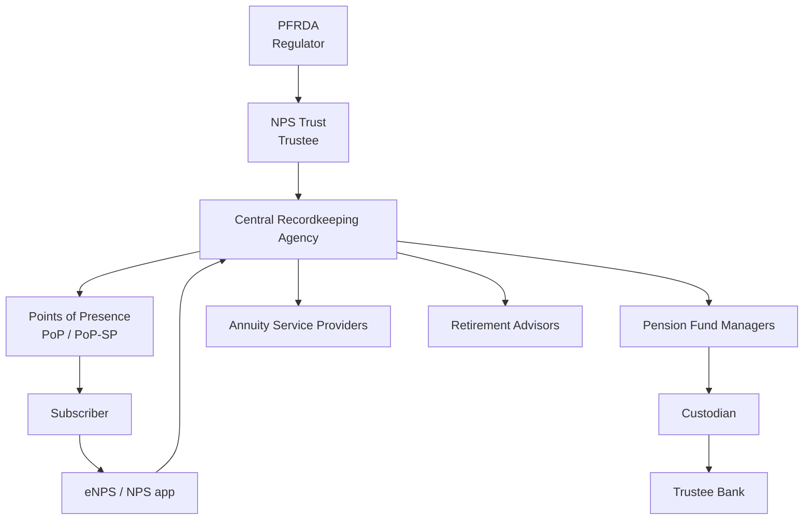
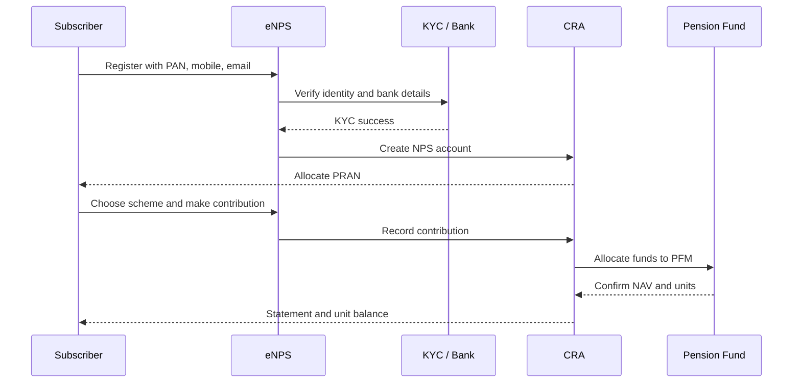

# NPS Platform

## What It Is

The NPS platform is the **operational architecture** that connects subscribers, record-keepers, pension funds, banks, and annuity providers. It is intentionally unbundled: no single entity controls the entire system.



The subscriber interacts through a PoP, eNPS, the NPS app, or an employer. The CRA records the account. The PFM invests. The custodian safekeeps securities. The trustee bank settles cash. Annuity providers convert the corpus into pension at exit.

---

## The Intermediaries

| Entity | Role |
|---|---|
| **PFRDA** | Regulator; sets NPS, APY, UPS, and exit rules |
| **NPS Trust** | Holds and administers NPS assets in trust for subscribers |
| **CRA** | Central record-keeper; issues PRAN, maintains accounts, processes transactions |
| **PoP / PoP-SP** | First point of contact; onboarding, contributions, service requests |
| **Pension Fund Manager (PFM)** | Invests contributions according to the chosen scheme |
| **Custodian** | Safekeeps securities and settles trades |
| **Trustee Bank** | Handles cash flows and settlement |
| **Annuity Service Provider (ASP)** | Sells annuities at exit |
| **Retirement Advisor** | Helps subscribers choose schemes and plan retirement |

### Central Recordkeeping Agencies

PFRDA has registered multiple CRAs:

| CRA | Portal |
|---|---|
| **Protean eGov Technologies** | [npscra.proteantech.in](https://www.npscra.proteantech.in/) |
| **CAMS** | [camsnps.in](https://www.camsnps.in/) |
| **KFin Technologies** | [nps.kfintech.com](https://nps.kfintech.com/) |

You choose a CRA when you open the account. The CRA issues your PRAN and provides the portal or app you use for most transactions.

---

## PRAN

**PRAN** stands for **Permanent Retirement Account Number**. It is the unique 12-digit identifier for your NPS account.

```
PRAN = primary key for the subscriber
Tier I and Tier II = sub-accounts under the same PRAN
```

PRAN stays with you across jobs, cities, and employers. If you change jobs, give your new employer the PRAN so contributions continue in the same account.

Keep these details safe:

- PRAN
- CRA name
- Registered mobile number and email
- Nominee details
- Bank account linked to NPS

---

## eNPS

**eNPS** is the online NPS onboarding and contribution platform operated by the NPS Trust.

You can use eNPS to:

- Open a Tier I account
- Open a Tier II account if you already have an active Tier I
- Complete KYC
- Choose a CRA and pension fund manager
- Make contributions
- Check account details and statements
- Raise service requests

### Registration flow



The exact KYC method depends on the channel. Aadhaar-based online KYC, PAN verification, and bank verification are common.

---

## Contribution Channels

| Channel | How It Works | Best For |
|---|---|---|
| **PoP** | Visit a bank or PoP branch and submit a contribution slip | Offline users, cash/cheque |
| **eNPS** | Log in and pay online | Individual subscribers |
| **NPS app** | Mobile contribution and account access | Quick top-ups |
| **D-Remit** | Virtual ID linked to PRAN; pay via NEFT, RTGS, or UPI | Recurring or large contributions |
| **Employer payroll** | Employer deducts and remits corporate NPS contributions | Salaried employees |
| **Bank standing instruction** | Automatic periodic debit | Disciplined monthly investing |

### D-Remit

**D-Remit** is a contribution facility where the CRA issues a virtual ID linked to your PRAN. You can transfer funds using NEFT, RTGS, or UPI.

```
PRAN → virtual ID → bank transfer → CRA matches payment → PFM allocates units
```

The virtual ID removes the need to enter PRAN and scheme details for every transfer. Check the cut-off time if you care about same-day NAV.

---

## Account Operations

Most ongoing service requests can be done through the CRA portal, eNPS, or the NPS app.

| Operation | What Changes |
|---|---|
| **Contribution** | Adds money; units are allotted at the applicable NAV |
| **Scheme change** | Moves future contributions or existing units between schemes |
| **PFM change** | Switches the pension fund manager |
| **Investment option change** | Moves between Active Choice and Auto Choice |
| **Tier II activation** | Opens the optional investment account (residents only) |
| **One-way switch** | Moves funds from Tier II to Tier I |
| **Nomination update** | Changes who receives the corpus on death |
| **KYC update** | Updates address, mobile, email, bank, or identity details |
| **Partial withdrawal** | Withdraws up to 25% of own contributions after 3 years |
| **Exit request** | Processes lump sum and annuity at normal or premature exit |
| **Grievance** | Raises and tracks a complaint with the CRA or NPS Trust |

Tier II activation requires an active Tier I. NRIs and OCIs cannot activate Tier II.

---

## Statements and NAV

NPS is unit-based. Your contribution buys units at the applicable **Net Asset Value (NAV)**.

```
Units allotted = Contribution amount / Applicable NAV
Corpus value   = Units × Current NAV
```

Statements show:

- Contributions
- Units allotted
- NAV
- Scheme-wise value
- Tier I and Tier II balances
- Transaction history

Check your statement periodically. Contributions can fail to map, units can be allotted at a different NAV than expected, and nomination or KYC details can become stale.

---

## Charges

NPS is low-cost, but not free. Charges can include:

- CRA account opening and annual maintenance
- Per-transaction charges
- PoP service charges
- Pension fund management fees
- Custodian and trustee fees
- Annuity purchase costs at exit

Fees are small relative to many active mutual funds, but they still compound. Compare the total cost, not just the headline fund management fee.

---

## Security and Hygiene

- Use only official NPS, CRA, and NPS Trust domains.
- Never share your PRAN, password, OTP, or bank credentials.
- Verify the CRA and PFM before investing.
- Keep your mobile number, email, and bank account updated.
- Nominate a beneficiary and review it after major life events.
- Download and store annual statements.
- Treat unsolicited calls offering "NPS withdrawals" or "high-return NPS schemes" as suspicious.

---

## Programming Analogy

```
NPS platform = event-driven financial system with multiple bounded contexts.

PRAN = primary key.
CRA = system of record and ledger.
eNPS = API gateway and onboarding UI.
PoP = branch/agent integration layer.
PFM = pluggable investment strategy.
Custodian = asset vault.
Trustee bank = payment settlement service.
D-Remit = virtual account mapping for incoming payments.
NAV = price feed used for unit accounting.
Exit engine = rules engine enforcing annuity and lump-sum limits.
```

The architecture is deliberately modular. Each intermediary has a narrow responsibility, which limits concentration of control and makes the system auditable.

### Engineering problems in this domain

- **Idempotency**: a contribution must not be credited twice if a payment callback is retried.
- **Reconciliation**: bank receipts, CRA records, and PFM units must agree.
- **Cut-off handling**: NAV depends on when funds are received and processed.
- **KYC state machine**: identity verification, re-KYC, and frozen accounts.
- **Rules engine**: age, corpus size, vesting period, and exit type determine allowed payouts.
- **Auditability**: every unit allotment and withdrawal must have an immutable trail.

---

## Common Mistakes

- **Losing the PRAN.** Recovering it is possible but adds friction. Store it securely.
- **Opening multiple accounts unnecessarily.** Use one PRAN across employers.
- **Not updating KYC.** An outdated mobile, address, or bank account can block transactions.
- **Ignoring the CRA choice.** The CRA is your service interface; choose one with a portal and support you can use.
- **Assuming eNPS is the only channel.** PoPs, employer payroll, and D-Remit may be better for some contributions.
- **Switching PFMs too often.** Chasing recent performance usually hurts long-term returns.
- **Not checking statements.** Errors are easier to fix when caught early.
- **Falling for withdrawal scams.** NPS exits have strict rules; no agent can bypass them.

---

## Interview Notes

- **System Design: "Design an NPS platform."** Separate onboarding, KYC, ledger, payments, NAV/unit accounting, scheme management, exit rules, and notifications. Use PRAN as the key and an immutable transaction ledger.
- **Payments: "How do you handle contributions?"** Use virtual accounts or payment references, idempotency keys, reconciliation jobs, and clear cut-off rules for NAV.
- **Data: "How do you compute account value?"** Store units and NAV history; value = units × current NAV. Recompute from the ledger, not from mutable balances.
- **Compliance: "How do you enforce exit rules?"** Use a versioned rules engine keyed on age, vesting, corpus size, exit type, and subscriber category. Log every decision.
- **Security: "What are the key controls?"** Strong KYC, multi-factor authentication, signed payment callbacks, audit logs, segregation of duties, and encryption of sensitive data.

---

## Revision Summary

| Concept | Definition |
|---|---|
| NPS Trust | Trustee that holds NPS assets for subscribers |
| CRA | Central record-keeper and account servicer |
| PoP | Point of Presence; onboarding and contribution touchpoint |
| PRAN | Unique 12-digit NPS account identifier |
| eNPS | Online NPS platform |
| D-Remit | Virtual-ID-based contribution facility |
| PFM | Pension fund manager that invests contributions |
| NAV | Net asset value used to allot units |
| ASP | Annuity service provider at exit |

- NPS is an unbundled architecture, not a single company
- PRAN is the primary key across jobs and locations
- CRA is the system of record; PFM manages investments
- eNPS, PoP, D-Remit, and payroll are different contribution channels
- Units × NAV = corpus value
- Most transactions can be done online through the CRA or eNPS

---

← [01-nps](01-nps.md) • [↑ Phase 9](README.md) • [↑ Finance](../README.md) • [03-ppf](03-ppf.md) →
