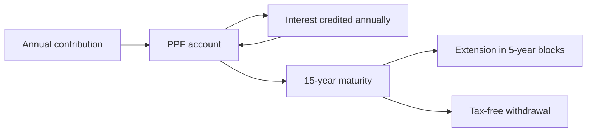

# Public Provident Fund (PPF)

## What It Is

The **Public Provident Fund (PPF)** is a government-backed, long-term savings scheme with a fixed interest rate, sovereign backing, and exempt-exempt-exempt (EEE) tax treatment for eligible contributions.

It is not a pension scheme in the strict sense. It is a **retirement and long-term compounding wrapper** that can provide a tax-free corpus or supplement a pension.



---

## Current Rate

The PPF rate is notified quarterly by the government.

| Period | Rate |
|---|---|
| October–December 2026 | **7.1% per annum** |

The rate is not fixed for the entire 15-year tenure. It can change every quarter. The current rate is a useful planning assumption, not a guarantee for future years.

Interest is compounded annually and credited at the end of the financial year.

---

## Key Rules

| Feature | Rule |
|---|---|
| **Eligibility** | Resident individual; one account per person |
| **Joint account** | Not allowed |
| **Minor account** | Guardian can open for a minor |
| **Minimum contribution** | ₹500 per financial year |
| **Maximum contribution** | ₹1.5 lakh per financial year |
| **Tenure** | 15 years |
| **Extension** | 5-year blocks, with or without further contributions |
| **Interest** | Compounded annually; rate reset quarterly |
| **Loan** | Available from the 3rd to the 6th financial year |
| **Withdrawal** | Available from the 7th financial year |
| **Premature closure** | Allowed after 5 years only on specified grounds |
| **Nomination** | Available and recommended |
| **Tax** | EEE for eligible contributions under the old regime |

The ₹1.5 lakh limit is per financial year. For a guardian, deposits in the guardian's own PPF account and accounts opened for minors are combined under the same ₹1.5 lakh cap. Tax deductions are subject to the overall ₹1.5 lakh ceiling under Section 123 (earlier 80C).

---

## How the 15-Year Cycle Works

```
Year 1  → account opens
Year 3  → loan window opens (FY3 to FY6)
Year 7  → withdrawal window opens
Year 15 → maturity
Year 16 → extend in 5-year blocks or close
```

Example: if the account is opened in FY 2025-26:

| Window | Approximate Years |
|---|---|
| Loan | FY 2027-28 to FY 2030-31 |
| Withdrawal | From FY 2031-32 |
| Maturity | FY 2040-41 |

Exact dates depend on the financial year and bank/post office rules.

---

## Contribution Limits

```
Minimum per year: ₹500
Maximum per year: ₹1,50,000
```

Contributions can be made in one lump sum or in installments, in multiples of ₹50. The maximum is not a target. Contribute what fits your overall asset allocation and liquidity needs.

Interest is calculated on the lowest balance between the close of the 5th day and the end of each month, then credited at the end of the financial year. Depositing before the 5th of a month lets that month's contribution earn interest.

### What happens if you contribute more than ₹1.5 lakh?

The excess is not eligible for the PPF tax benefit and may be returned without interest, depending on the scheme rules. Do not treat the account as an unlimited tax-free deposit.

---

## Loan Against PPF

PPF offers a loan facility before the withdrawal window opens.

| Feature | Rule |
|---|---|
| Availability | From the 3rd financial year to the 6th financial year |
| Loan amount | Up to 25% of the balance at the end of the second financial year preceding the loan year |
| Interest | 1% per annum if repaid within 36 months; 6% per annum if overdue |
| Repayment | Principal within 36 months; interest in up to two installments after principal repayment |
| Second loan | Not allowed while the first loan is outstanding |

A PPF loan can be useful for short-term liquidity, but it is not free money. Compare the loan cost with alternatives. Unpaid loan interest may be debited to the PPF account.

---

## Withdrawals

From the 7th financial year, you can withdraw from PPF without closing the account.

| Feature | Rule |
|---|---|
| First withdrawal | From the 7th financial year |
| Frequency | Generally one withdrawal per financial year |
| Maximum amount | Subject to the PPF withdrawal formula, broadly up to 50% of the eligible balance |
| Tax | Tax-free |
| Account status | Remains active |

The 50% is calculated on the lower of the balance at the end of the fourth financial year preceding the withdrawal year and the balance at the end of the preceding financial year. Withdrawals are not a substitute for an emergency fund. Keep separate liquidity for unexpected expenses.

---

## Premature Closure

Premature closure is allowed only after 5 years and only for specified reasons such as:

- Medical treatment of the account holder or a dependent
- Higher education of the account holder or children
- Other grounds permitted by the scheme

A premature closure generally attracts a 1% reduction in the interest payable. Do not assume PPF is liquid before maturity.

---

## Extension After Maturity

At maturity, you can:

1. **Close the account** and withdraw the corpus tax-free.
2. **Extend without further contributions** — the balance continues to earn interest.
3. **Extend with contributions** — continue contributing for 5-year blocks, subject to the annual limit.

Extension is useful if you do not need the money at 15 years. It keeps the tax-free compounding going and can serve as a retirement income bucket. For extension with contributions, submit the request within one year of maturity.

---

## Tax Treatment

PPF is the cleanest EEE product among the options covered in this phase under the old regime.

| Stage | Treatment |
|---|---|
| **Contribution** | Deduction up to ₹1.5 lakh under Section 123 (earlier 80C), old regime |
| **Interest** | Exempt |
| **Maturity / withdrawal** | Exempt |

Under the new tax regime, the contribution deduction is generally not available. Interest and maturity proceeds remain exempt, subject to the scheme conditions.

```
Old regime:  Exempt → Exempt → Exempt
New regime:  No deduction → Exempt → Exempt
```

PPF is still attractive in the new regime if you want tax-free interest and do not need liquidity. The lack of an upfront deduction reduces its relative advantage.

---

## Compounding Example

Assume ₹1.5 lakh contributed at the start of each year for 15 years at 7.1%, with the rate unchanged:

```
Total contributions: ₹22,50,000
Maturity value:      ~₹40,68,000
Interest earned:     ~₹18,18,000
```

This is an approximation. Actual values depend on the contribution dates, rate changes, and compounding method.

The key insight: the maturity value is almost **1.8× the contributions**, and the entire gain can be tax-free.

---

## PPF vs Fixed Deposit

| Feature | PPF | Bank FD |
|---|---|---|
| Backing | Government | Bank deposit insurance up to limits |
| Return | 7.1% (Oct–Dec 2026) | Bank-specific |
| Tenure | 15 years | Flexible |
| Liquidity | Restricted | Generally better |
| Tax on interest | Exempt | Taxed as income |
| Tax on maturity | Exempt | Taxed as income |
| Best for | Long-term tax-free compounding | Short-term safety and liquidity |

A taxable FD at a higher headline rate can lose to PPF on an after-tax basis, especially for high-income earners.

---

## Programming Analogy

```
PPF = a 15-year compounding job with strict rate limits and withdrawal guards.

Annual contribution = a bounded write to the account.
Interest = a yearly compounding function.
Loan = a temporary read with a cost.
Withdrawal = a guarded read after a lock-in period.
Extension = restarting the job with the existing state.
Tax = an exemption flag applied to contributions, interest, and maturity.
```

The account is simple, but the rules are stateful. Model the year, balance, contribution history, and withdrawal eligibility explicitly.

---

## Common Mistakes

- **Contributing only in March.** Earlier contributions earn interest for more of the year.
- **Treating PPF as a liquid emergency fund.** The lock-in and withdrawal rules are strict.
- **Overfunding a minor's account without checking the limit.** The ₹1.5 lakh annual cap applies per account.
- **Assuming the 7.1% rate is fixed for 15 years.** It is reset quarterly.
- **Ignoring the loan window.** A PPF loan can be cheaper or more expensive than alternatives; compare.
- **Closing at maturity by default.** Extension may be better if you do not need the money.
- **Forgetting nomination.** A nominee reduces friction for your family.
- **Opening multiple accounts.** Only one PPF account per person is allowed.

---

## Interview Notes

- **Product: "Build a PPF calculator."** Model annual contributions, rate resets, compounding, loan eligibility, withdrawal eligibility, and maturity. Show year-by-year balances.
- **Data: "How do you calculate PPF returns?"** Use the actual contribution dates and the applicable rates. XIRR is useful when contributions are irregular.
- **Tax: "Why is PPF EEE?"** Contributions qualify for deduction, interest is exempt, and maturity is exempt, subject to limits and conditions.
- **System Design: "Model a small-savings scheme."** Use a state machine for account lifecycle, a rate table by quarter, and rule-based eligibility for loans, withdrawals, and premature closure.

---

## Revision Summary

| Concept | Definition |
|---|---|
| PPF | Government-backed 15-year savings scheme |
| EEE | Exempt contributions (old regime), exempt interest, exempt maturity |
| Contribution limit | ₹500 minimum, ₹1.5 lakh maximum per year |
| Tenure | 15 years, extendable in 5-year blocks |
| Loan window | 3rd to 6th financial year |
| Withdrawal window | From the 7th financial year |
| Premature closure | After 5 years, only on specified grounds |
| Rate reset | Quarterly by the government |

- PPF is a long-term, tax-free compounding wrapper
- The rate is current, not guaranteed for 15 years
- Liquidity is restricted; keep a separate emergency fund
- Contribution timing affects the interest earned
- Extension can be better than closing at maturity

---

← [02-nps-platform](02-nps-platform.md) • [↑ Phase 9](README.md) • [↑ Finance](../README.md) • [04-epf-vpf-and-eps](04-epf-vpf-and-eps.md) →
