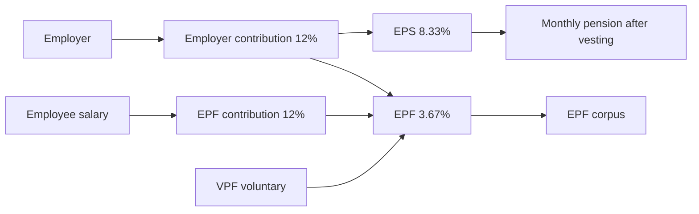

# EPF, VPF, and EPS

## What It Is

Salaried employees covered by the Employees' Provident Fund Organisation (EPFO) build retirement savings through three linked components:

| Component | What It Is | Who Contributes |
|---|---|---|
| **EPF** | Provident fund savings account | Employee + employer |
| **VPF** | Voluntary extra provident fund contribution | Employee only |
| **EPS** | Defined-benefit pension scheme | Employer + government |



EPF and VPF build a lump-sum corpus. EPS builds a monthly pension. They are related but not the same product.

The EPF and Miscellaneous Provisions Act, 1952 has been subsumed into the **Code on Social Security, 2020**, effective 21 November 2025. The **Employees' Pension Scheme, 2026** came into force on 29 June 2026.

---

## Wage Ceiling

The statutory wage ceiling for mandatory EPFO coverage was raised from ₹15,000 to **₹25,000 per month**, effective **17 September 2026**, via notification **S.O. 5109(E)**.

| Period | Wage Ceiling |
|---|---|
| Up to 16 September 2026 | ₹15,000 per month |
| From 17 September 2026 | ₹25,000 per month |

Employees earning up to ₹25,000 per month are now mandatorily covered under EPF, EPS, and EDLI, subject to the scheme rules. Employees above the ceiling may still be covered in some cases, and existing members can continue.

### Contribution at the ceiling

At ₹25,000 monthly wages:

| Contribution | Rate | Amount |
|---|---|---|
| Employee EPF | 12% | ₹3,000 |
| Employer EPS | 8.33% | ₹2,083 |
| Employer EPF | 3.67% | ₹917 |
| EDLI | 0.5% | ₹125 |
| EPF admin charges | 0.5% | ₹125 |

The employer's 12% is split between EPS and EPF. The EPS share is capped by the applicable wage ceiling; the remainder goes to EPF.

---

## EPF

**Employees' Provident Fund (EPF)** is a mandatory retirement savings account for covered employees.

| Feature | Rule |
|---|---|
| Employee contribution | 12% of basic + DA |
| Employer contribution | 12% of basic + DA |
| Employer split | 8.33% to EPS, 3.67% to EPF (subject to ceiling) |
| Interest | 8.25% for FY 2025-26; notified annually |
| Tax | EEE (old regime) subject to conditions |
| Withdrawal | Retirement, eligible advance, or specific conditions |
| Portability | Transferable across employers via UAN |

EPF is a debt-like, government-administered compounding account. It is the stable base of many salaried retirement portfolios.

### UAN and transfers

Your **Universal Account Number (UAN)** identifies you across employers. When you change jobs, transfer the old EPF account to the new one instead of withdrawing.

```
Job change → provide UAN to new employer → transfer old EPF → keep compounding
```

Frequent withdrawals reset compounding and can create tax and retirement gaps.

---

## VPF

**Voluntary Provident Fund (VPF)** is an optional employee contribution on top of the mandatory EPF contribution.

| Feature | Rule |
|---|---|
| Who contributes | Employee only |
| Employer match | None |
| Limit | Typically up to 100% of basic + DA, subject to payroll policy |
| Interest | Same as EPF |
| Tax | Same EEE framework as EPF, subject to limits |
| Liquidity | Same EPF withdrawal and transfer rules |

VPF is useful when you want more safe, tax-advantaged compounding and have already filled other goals. It is not a substitute for equity exposure over long horizons.

### VPF tax nuance

The employee's own EPF + VPF contribution is counted together for the ₹2.5 lakh annual tax-free interest threshold. Interest on contributions above that threshold is taxable.

- ₹2.5 lakh threshold: employee contributions to EPF + VPF
- ₹5 lakh threshold: cases with no employer contribution, such as GPF
- ₹7.5 lakh aggregate: employer contributions to EPF, NPS, and superannuation for tax exemption

---

## EPS

**Employees' Pension Scheme (EPS)** is a defined-benefit pension scheme funded by the employer's EPS share and a government contribution.

| Feature | Rule |
|---|---|
| Employer contribution | 8.33% of wages, subject to the wage ceiling |
| Government contribution | 1.16% of wages up to ₹15,000 per month |
| Vesting | At least 10 years of pensionable service |
| Retirement age | 58 years |
| Early pension | From age 50, with a reduction |
| Pension formula | `Pensionable salary × Pensionable service / 70` |
| Weightage | 2 extra years for 20+ years of service, where applicable |
| Family pension | Available to eligible family members |

### Pension formula

```
Monthly EPS pension =
    Pensionable salary × Pensionable service
    ─────────────────────────────────────────
                      70
```

Example at ₹15,000 pensionable salary:

| Pensionable Service | Monthly Pension |
|---|---|
| 10 years | ₹2,143 |
| 20 years | ₹4,286 |
| 30 years | ₹6,429 |
| 35 years | ₹7,500 |

At ₹25,000 pensionable salary, the arithmetic upper bound for 35 years would be ₹12,500. EPFO guidance indicates pensionable wages may be considered up to the revised ceiling, but confirm your actual entitlement from your contribution history.

### The ₹25,000 nuance

The 2026 changes raised the EPFO wage ceiling to ₹25,000. EPFO guidance indicates pensionable wages may be considered up to the revised ceiling, so eligible members may receive a higher pension subject to the EPS formula and service conditions. However:

- The government's own 1.16% contribution remains limited to wages up to ₹15,000.
- Existing pensions do not automatically increase because the contribution ceiling changed.
- Your actual pensionable salary depends on your contribution history and EPFO records.

Model both ₹15,000 and ₹25,000 scenarios. Confirm your pensionable wages with EPFO before relying on a number.

### Early pension

EPS pension normally starts at 58. You can start earlier from age 50, but the pension is reduced by about 4% for each year before 58. Early pension is a trade-off: more years of income, lower monthly amount.

### EPS vs NPS

| Feature | EPS | NPS |
|---|---|---|
| Type | Defined benefit | Defined contribution |
| Return | Formula-based pension | Market-linked |
| Risk bearer | Scheme/government | Subscriber |
| Contribution | Employer-funded | Employee + employer/voluntary |
| Lump sum | Limited | Larger lump sum possible |
| Best for | Guaranteed monthly income | Growth and flexibility |

---

## Tax Treatment

EPF and VPF are EEE under the old regime, subject to conditions.

| Stage | Treatment |
|---|---|
| **Contribution** | Employee contribution eligible under Section 123 (earlier 80C), old regime; employer contribution generally exempt within limits |
| **Interest** | Exempt up to the employee contribution threshold; excess can be taxable |
| **Withdrawal** | Tax-free after 5 years of continuous service; taxable before that except specified cases |

### Key thresholds

| Threshold | Effect |
|---|---|
| ₹2.5 lakh employee EPF + VPF contribution per year | Interest above this is taxable |
| ₹5 lakh employee contribution where there is no employer contribution | Higher interest-exemption threshold |
| ₹7.5 lakh aggregate employer contribution to EPF + NPS + superannuation (non-government employees) | Excess employer contribution can be taxable |

Premature EPF withdrawal before 5 years can trigger tax and TDS. Withdrawal after 5 years of continuous service is generally tax-free.

---

## EPF vs PPF vs NPS

| Feature | EPF/VPF | PPF | NPS |
|---|---|---|---|
| Who | Salaried employees | Any eligible resident | Any eligible citizen, NRI, OCI |
| Return | 8.25% (FY 2025-26) | 7.1% (Oct–Dec 2026) | Market-linked |
| Risk | Government-administered | Sovereign-backed | Market risk |
| Employer match | Yes | No | Possible through corporate NPS |
| Liquidity | Transfer/eligible withdrawal | Loan/withdrawal rules | Restricted until exit |
| Tax | EEE (old regime) subject to limits | EEE (old regime) | Partial EET |
| Best for | Salaried debt base | Tax-free long-term compounding | Equity growth with pension rules |

---

## Programming Analogy

```
EPF = mandatory payroll deduction with a stateful ledger.
UAN = stable subscriber key across employers.
VPF = optional extra write to the same ledger.
EPS = separate defined-benefit function with vesting and age rules.
Wage ceiling = input validation limit.
Employer split = allocation rule: 8.33% EPS, remainder EPF.
Pension formula = deterministic function of salary and service.
```

The payroll engine must handle ceilings, splits, rounding, transfers, interest accrual, and tax thresholds. Small rule errors compound across millions of members.

---

## Common Mistakes

- **Withdrawing EPF on every job change.** Transfer instead; withdrawals reset compounding and can be taxed.
- **Ignoring VPF.** It is a simple way to add safe, tax-advantaged savings if you have excess cash flow.
- **Assuming EPS will be a large pension.** At the ₹15,000 ceiling, 35 years of service gives about ₹7,500/month.
- **Forgetting the 10-year EPS vesting period.** Short service may produce a scheme certificate or withdrawal instead of a pension.
- **Misunderstanding the ₹25,000 ceiling.** It changes contribution coverage, not automatically every existing pension.
- **Overlooking the ₹2.5 lakh EPF/VPF interest threshold.** High contributors can have taxable interest.
- **Not checking UAN and KYC.** Incorrect details block transfers and withdrawals.
- **Treating EPF as your entire retirement plan.** It is a debt base, not a complete portfolio.

---

## Interview Notes

- **Payroll: "Calculate EPF, EPS, and EDLI for ₹25,000 wages."** Employee 12% = ₹3,000; employer EPS 8.33% = ₹2,083; employer EPF = ₹917; EDLI 0.5% = ₹125; admin 0.5% = ₹125.
- **Data: "How do you model EPS pension?"** Use pensionable salary, pensionable service, the /70 formula, vesting, early-retirement reduction, and the applicable wage ceiling. Show sensitivity to the ceiling.
- **System Design: "Build an EPF ledger."** Use UAN as the key, employer/employee contribution events, interest accrual, transfer events, and immutable statements. Handle rounding and ceiling changes by effective date.
- **Compliance: "Why is the wage ceiling important?"** It determines mandatory coverage, contribution amounts, EPS allocation, and EDLI benefits. Mid-month changes require pro-rata handling.

---

## Revision Summary

| Concept | Definition |
|---|---|
| EPF | Mandatory provident fund savings for covered employees |
| VPF | Voluntary extra employee EPF contribution |
| EPS | Defined-benefit pension funded by employer contributions |
| UAN | Universal Account Number for EPF portability |
| Wage ceiling | Maximum wage used for mandatory EPFO coverage |
| EPS formula | Pensionable salary × pensionable service / 70 |
| Vesting | Minimum 10 years for EPS pension |
| EDLI | Deposit-linked insurance benefit |

- EPF/VPF are the stable debt base of a salaried retirement portfolio
- EPS is a modest defined-benefit pension, not a full replacement
- The wage ceiling rose to ₹25,000 on 17 September 2026
- Transfer EPF across jobs; do not withdraw by default
- Tax benefits are strong but subject to contribution and interest thresholds

---

← [03-ppf](03-ppf.md) • [↑ Phase 9](README.md) • [↑ Finance](../README.md) • [05-other-pension-schemes](05-other-pension-schemes.md) →
