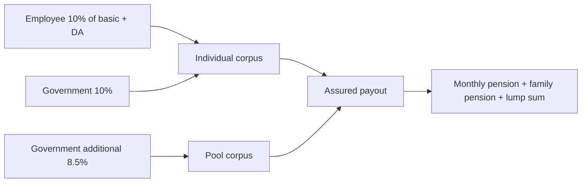

# Other Pension Schemes

## What It Is

India's retirement system is not one scheme. It is a mix of:

- **Employment-linked savings:** EPF, VPF, EPS
- **Market-linked pensions:** NPS, NPS Vatsalya
- **Assured government pensions:** UPS, APY
- **Small-savings income products:** SCSS, SSY

Each solves a different problem. The right choice depends on employment status, age, income, tax regime, liquidity needs, and how much guaranteed income you want.

---

## Unified Pension Scheme (UPS)

**UPS** is an option under NPS for **Central Government employees**. It became operational on **1 April 2025**.

It is a fund-based scheme with an assured payout, not a traditional unfunded defined-benefit pension.



### Eligibility

- Existing Central Government employees under NPS as on 1 April 2025
- New recruits joining Central Government service on or after 1 April 2025
- Eligible retired NPS subscribers who retired on or before 31 March 2025, subject to conditions
- Legally wedded spouse of an eligible deceased subscriber, in specified cases

The option window for existing employees and eligible retirees closed on **30 November 2025**. New recruits must exercise the UPS option within 30 days of joining, unless extended; otherwise they continue under NPS.

### Contributions

| Contributor | Contribution |
|---|---|
| Employee | 10% of basic pay + DA |
| Central Government | 10% of basic pay + DA |
| Central Government additional | About 8.5% of basic + DA to a pool corpus |

### Benefits

| Benefit | Rule |
|---|---|
| Full assured payout | 50% of average basic pay of the last 12 months, after 25 years of qualifying service |
| Proportionate payout | Between 10 and 25 years of service |
| Minimum guaranteed payout | ₹10,000 per month after at least 10 years of service |
| Family payout | 60% of the admissible payout to the legally wedded spouse |
| Dearness relief | Indexed to inflation, similar to serving employees |
| Lump sum | 1/10 of basic + DA for every completed 6 months of service |
| Final withdrawal | Up to 60% of individual corpus or benchmark corpus, whichever is lower; reduces the assured payout |

### Important nuance

UPS payouts are assured **subject to the individual corpus being adequate relative to the benchmark corpus**. If the individual corpus is lower, the admissible payout can be reduced proportionately. UPS is not a guarantee that ignores contributions and investment outcomes.

A UPS subscriber also gets a **one-time, one-way switch back to NPS**, subject to the notified timing conditions. After switching back, UPS assured-payout benefits no longer apply.

### UPS vs NPS

| Feature | UPS | NPS |
|---|---|---|
| Assured payout | Yes, subject to conditions | No |
| Equity exposure | Through NPS architecture | Yes |
| Lump sum | Up to 60% with payout reduction | Up to 80% at normal exit |
| Inflation protection | Dearness relief | Market-linked corpus |
| Best for | Employees who value predictable pension | Employees who want higher growth and flexibility |

UPS is generally more valuable for mid-career employees with fewer years to compound. NPS can be more attractive for young employees with a long equity runway.

---

## Atal Pension Yojana (APY)

**APY** is a government-backed pension scheme for Indian citizens, focused on the unorganised sector and low-income workers.

| Feature | Rule |
|---|---|
| Age at entry | 18 to 40 years |
| Eligibility | Savings bank or post office account; Indian citizen |
| Income-tax payers | Not eligible to open a new account from 1 October 2022 |
| Pension | ₹1,000, ₹2,000, ₹3,000, ₹4,000, or ₹5,000 per month |
| Pension start | Age 60 |
| Guarantee | Minimum pension guaranteed by the Government of India |
| Spouse | Receives the same pension after the subscriber's death |
| Nominee | Receives the accumulated pension wealth after both subscriber and spouse |
| Contributions | Auto-debit monthly, quarterly, or half-yearly |
| Accounts | One APY account per person |

### Contribution examples

Contributions depend on entry age and the chosen pension.

| Pension | Entry Age 18 | Entry Age 40 |
|---|---|---|
| ₹1,000/month | ₹42/month | ₹291/month |
| ₹5,000/month | ₹210/month | ₹1,454/month |

Joining early reduces the monthly contribution because the corpus compounds for longer.

### APY risks and limits

- The pension is nominal. Inflation erodes its purchasing power over decades.
- Contributions are fixed at entry; the final pension is not inflation-indexed.
- It is a small guaranteed floor, not a complete retirement plan.
- Delayed contributions attract overdue interest.
- New accounts are closed to current or past income-tax payers.

APY is best for workers who need a simple, government-guaranteed pension floor and may not have EPF or NPS coverage.

---

## Senior Citizens' Savings Scheme (SCSS)

**SCSS** is a government small-savings scheme for senior citizens. It pays regular interest and is useful for retirement income.

| Feature | Rule |
|---|---|
| Eligibility | Individuals aged 60 and above; some early-retirement categories may qualify |
| Tenure | 5 years |
| Extension | One 3-year extension |
| Interest | 8.2% for October–December 2026; paid quarterly |
| Maximum investment | ₹30 lakh per individual |
| Tax deduction | Up to ₹1.5 lakh under Section 123 (earlier 80C), old regime |
| Interest tax | Taxable as income |
| Premature closure | Before 1 year, no interest; after 1 year, penalty applies |
| Joint account | Available with a spouse, subject to rules |

The rate at opening is locked for the 5-year tenure; 8.2% applies to accounts opened in October–December 2026. SCSS is an income product, not a growth product. The quarterly interest can supplement a pension, but the principal does not grow with inflation.

### SCSS vs fixed deposit

| Feature | SCSS | Bank FD |
|---|---|---|
| Rate | 8.2% (Oct–Dec 2026) | Bank-specific |
| Backing | Government | Bank + deposit insurance |
| Tenure | 5 years | Flexible |
| Payout | Quarterly | Bank-specific |
| Tax | Interest taxable; contribution may qualify | Interest taxable |
| Best for | Senior citizens needing regular income | General liquidity |

---

## Sukanya Samriddhi Yojana (SSY)

**SSY** is a government savings scheme for a girl child. It is not a pension scheme, but it is a powerful long-term, tax-free compounding wrapper for education, marriage, or a daughter's future.

| Feature | Rule |
|---|---|
| Eligibility | Girl child below 10 years |
| Account | One account per girl; operated by guardian |
| Tenure | 21 years from opening; can close on marriage after 18 |
| Interest | 8.2% for October–December 2026 |
| Minimum contribution | ₹250 per year |
| Maximum contribution | ₹1.5 lakh per financial year |
| Tax | EEE for eligible contributions under the old regime |
| Partial withdrawal | Up to 50% after age 18 for education; marriage after 18 permits closure |

The 8.2% rate is reset quarterly and applies to the whole balance, so it is not guaranteed for all 21 years. SSY is best for parents who want a safe, tax-free, long-horizon corpus for a daughter. It should not replace equity for a 20-year goal, but it provides a stable debt foundation.

---

## NPS Vatsalya

**NPS Vatsalya** is a pension account for minors, operated by a parent or guardian.

| Feature | Rule |
|---|---|
| Eligibility | Indian citizen, including NRI/OCI, below 18 years |
| Account holder | Minor is the sole beneficiary; guardian operates |
| Minimum contribution | ₹250 at opening and ₹250 per year |
| Maximum contribution | No limit |
| Contributors | Parents, guardians, relatives, and friends |
| Partial withdrawal | After 3 years, up to 25% of own contributions; 2 times before 18 and 2 times between 18 and 21 |
| At age 18 | Fresh KYC required; can continue to 21 |
| Options at 18–21 | Shift to NPS, withdraw up to 80% + 20% annuity, or withdraw 100% if corpus is below ₹8 lakh |
| If no option by 21 | Automatically shifts to NPS in a higher-equity scheme |

NPS Vatsalya combines long-term compounding with NPS investment choices. Contributions qualify under Section 124(4) within the ₹50,000 NPS basket in the old regime, and exit follows NPS tax rules. It is useful for building a child's retirement or long-term corpus early, but the money is locked up for a long time.

---

## Scheme Comparison

| Scheme | Guarantee | Return | Liquidity | Tax | Best For |
|---|---|---|---|---|---|
| **UPS** | Assured payout, subject to conditions | Fund-based | Restricted | NPS-like | Central Government employees wanting predictable pension |
| **APY** | Government-guaranteed pension | Implicit | Low | Deduction (old regime); pension taxable | Low-income/unorganised workers |
| **SCSS** | Government-backed | 8.2% (Oct–Dec 2026) | Medium | Interest taxable; 80C/123 deduction (old regime) | Senior citizens needing regular income |
| **SSY** | Government-backed | 8.2% (Oct–Dec 2026) | Low | EEE (old regime) | Parents saving for a girl child |
| **NPS Vatsalya** | Market-linked | Market-linked | Low | NPS-like | Long-term savings for minors |
| **NPS** | Market-linked | Market-linked | Low | Partial EET | Retirement growth with pension rules |
| **PPF** | Government-backed | 7.1% (Oct–Dec 2026) | Low | EEE (old regime) | Tax-free long-term compounding |
| **EPF/VPF** | Government-administered | 8.25% (FY 2025-26) | Low | EEE (old regime) subject to limits | Salaried employees |

Rates are as of October–December 2026 unless stated otherwise. Small-savings rates are reviewed quarterly.

---

## Programming Analogy

```
Retirement system = a portfolio of contracts with different guarantees.

UPS = assured-payout contract with a benchmark-corpus check.
APY = guaranteed minimum pension contract.
SCSS = fixed-income annuity-like contract for seniors.
SSY = long-duration tax-free compounding contract for a child.
NPS Vatsalya = NPS contract with a guardian-controlled state.
```

Each scheme has a different **state machine**: eligibility, contribution rules, lock-in, withdrawal conditions, and tax treatment. Do not compare them on return alone.

---

## Common Mistakes

- **Comparing only headline returns.** Guarantees, liquidity, tax, and inflation matter just as much.
- **Assuming UPS is a pure government pension.** It is fund-based and subject to corpus conditions.
- **Opening APY after becoming an income-tax payer.** New accounts are not allowed.
- **Using SCSS for growth.** It pays income; the principal does not grow with inflation.
- **Overfunding SSY and ignoring equity.** A 20-year goal still needs growth.
- **Treating NPS Vatsalya as a liquid child account.** It has long lock-ins and exit rules.
- **Ignoring tax on SCSS interest.** It is taxable at your slab rate.
- **Not checking the current rate.** Small-savings rates change quarterly.

---

## Interview Notes

- **Product: "Compare APY and NPS for a low-income worker."** APY offers a small guaranteed pension and simple auto-debit; NPS offers market-linked growth but requires more financial literacy and has stricter exit rules.
- **Data: "Model APY contributions."** Inputs: entry age, pension slab, frequency, and mortality assumptions. Output: contribution schedule and expected corpus.
- **System Design: "Build a small-savings scheme engine."** Use a product-configuration layer for rates, tenure, limits, and payout frequency; a rules engine for eligibility and premature closure; and a ledger for accruals and payouts.
- **Policy: "Why does UPS exist?"** It addresses demand for an assured pension within a funded, contributory NPS framework, while retaining market-based investing.

---

## Revision Summary

| Concept | Definition |
|---|---|
| UPS | Assured-payout option under NPS for Central Government employees |
| APY | Government-guaranteed pension for eligible citizens aged 18–40 |
| SCSS | 5-year senior-citizen income scheme with quarterly interest |
| SSY | Long-term tax-free savings scheme for a girl child |
| NPS Vatsalya | NPS account for minors, operated by a guardian |
| Assured payout | Promised pension subject to eligibility and corpus conditions |
| Small-savings rate | Government-notified rate, reviewed quarterly |

- Different schemes solve different problems: growth, guarantee, income, or tax-free compounding
- APY and UPS provide guaranteed or assured income, but with limits
- SCSS is for income, not growth
- SSY and NPS Vatsalya are long-horizon child savings wrappers
- Always compare after-tax, after-inflation outcomes

---

← [04-epf-vpf-and-eps](04-epf-vpf-and-eps.md) • [↑ Phase 9](README.md) • [↑ Finance](../README.md) • [06-pension-comparison-and-selection](06-pension-comparison-and-selection.md) →
