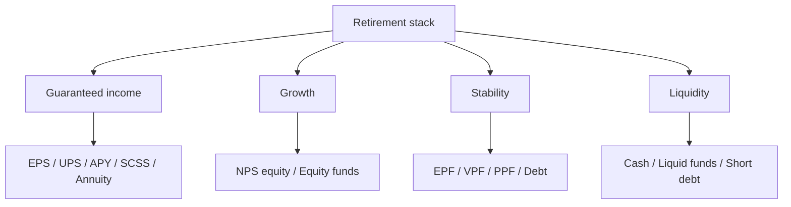
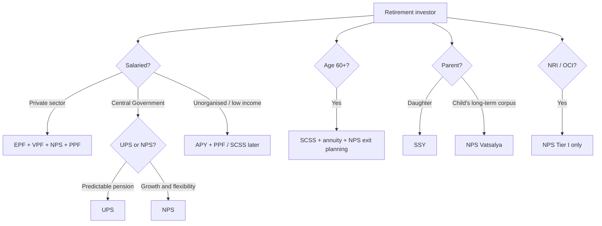
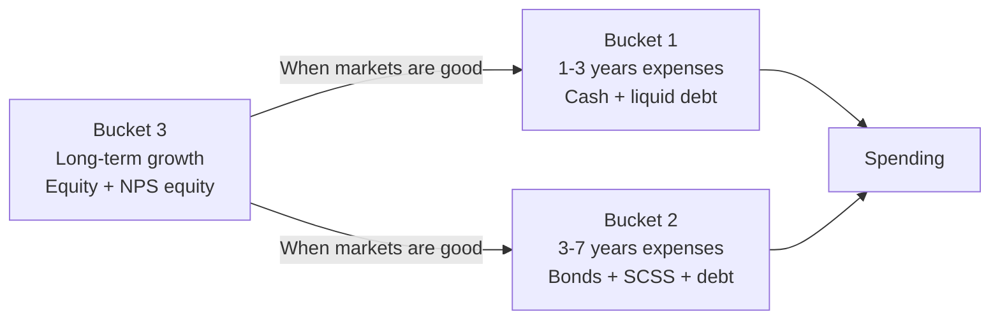

# Pension Comparison and Selection

## What It Is

Pension selection is not about finding the single best scheme. It is about building a **retirement stack** with four jobs:

| Job | Purpose | Typical Instruments |
|---|---|---|
| **Guaranteed income** | Cover essential expenses | EPS, UPS, APY, annuities, SCSS |
| **Growth** | Beat inflation over long horizons | NPS equity, equity funds |
| **Stability** | Reduce volatility near retirement | EPF, VPF, PPF, debt |
| **Liquidity** | Handle emergencies and bad markets | Cash, liquid funds, short debt |

A good retirement plan combines these layers. A single scheme rarely does all four well.



---

## Scheme Comparison

| Scheme | Guarantee | Return | Liquidity | Tax | Best For |
|---|---|---|---|---|---|
| **NPS Tier I** | Market-linked | Market-linked | Low | Partial EET | Long-term retirement growth |
| **NPS Tier II** | Market-linked | Market-linked | High | No special benefit | Flexible investing alongside NPS |
| **PPF** | Government-backed | 7.1% (Oct–Dec 2026) | Low | EEE (old regime) | Tax-free long-term compounding |
| **EPF** | Government-administered | 8.25% (FY 2025-26) | Low | EEE (old regime) subject to limits | Salaried debt base |
| **VPF** | Government-administered | Same as EPF | Low | EEE (old regime) subject to limits | Extra safe compounding |
| **EPS** | Defined benefit | Formula-based | Pension only | Pension taxable | Guaranteed monthly pension |
| **UPS** | Assured payout, subject to conditions | Fund-based | Low | NPS-like | Central Government employees |
| **APY** | Government-guaranteed | Implicit | Low | Deduction (old regime); pension taxable | Low-income workers |
| **SCSS** | Government-backed | 8.2% (Oct–Dec 2026) | Medium | Interest taxable | Senior-citizen income |
| **SSY** | Government-backed | 8.2% (Oct–Dec 2026) | Low | EEE (old regime) | Girl child's long-term goal |
| **NPS Vatsalya** | Market-linked | Market-linked | Low | NPS-like | Minor's long-term savings |
| **Annuity** | Insurer-backed | Contractual | None after purchase | Income taxable | Longevity insurance |

Rates are as of October–December 2026 unless stated otherwise. Small-savings rates change quarterly. Tax rules can change.

---

## Selection Framework

Use this sequence instead of starting with products.

### Step 1: Estimate the target

```
Annual retirement expense
    = today's expense × (1 + inflation)^years
Corpus
    = annual retirement expense / withdrawal rate
```

Use a conservative withdrawal rate and stress-test it.

### Step 2: Build the guaranteed floor

Cover essential expenses with predictable income:

- EPS pension if eligible
- UPS if you are a Central Government employee
- APY if you need a small guaranteed pension
- Annuity purchased at retirement
- SCSS for near-retirement income

The goal is not to guarantee your entire lifestyle. The goal is to guarantee **essentials**: housing, food, health insurance, utilities, and basic transport.

### Step 3: Add growth

Use NPS equity, equity mutual funds, or both for long-term inflation protection.

- Young investors can hold more equity.
- Mid-career investors should balance growth with increasing stability.
- Near-retirement investors should keep enough equity to fight inflation but enough debt to avoid forced selling.

### Step 4: Add stability

Use EPF, VPF, PPF, and debt to reduce portfolio volatility and fund withdrawals during bad markets.

### Step 5: Keep liquidity

Hold 2–3 years of essential expenses in cash, liquid funds, or short-duration debt. This prevents selling long-term assets at the wrong time.

### Step 6: Optimise tax

Compare the old and new tax regimes. The best contribution mix depends on your regime, income, and employer benefits.

### Step 7: Review annually

Update contributions, asset allocation, insurance, nominations, and withdrawal assumptions.

---

## Decision Tree



This is a starting point, not personal financial advice. Tax, family, health, and employment details can change the answer.

---

## Portfolio Construction by Age

| Stage | Equity | Debt / Stable | Retirement Actions |
|---|---|---|---|
| **20s–30s** | 70–90% | 10–30% | Start EPF/VPF, open NPS, build emergency fund |
| **30s–40s** | 65–80% | 20–35% | Increase contributions, review nominations, add PPF |
| **40s–50s** | 50–70% | 30–50% | Build the stable bucket, review insurance |
| **50s–60s** | 35–55% | 45–65% | De-risk gradually, plan NPS exit, consider SCSS |
| **60+** | 20–40% | 60–80% | Hold 2–3 years cash, annuitise essentials, review annually |

These ranges are illustrative. Personal risk tolerance, health, family support, and guaranteed income change the right mix.

### The retirement bucket strategy



Refill Bucket 1 from Bucket 2, and Bucket 2 from Bucket 3 when markets are favourable. This reduces the chance of selling equity in a crash.

---

## Annuities

An **annuity** converts a lump sum into periodic income, usually for life. It is the main tool for **longevity insurance**: protecting against the risk of living longer than expected.

| Annuity Type | What It Does |
|---|---|
| **Life annuity** | Pays income for the annuitant's life |
| **Joint life annuity** | Continues for the spouse after the annuitant's death |
| **With return of purchase price** | Returns the purchase price to nominees; lower income |
| **Without return of purchase price** | Higher income; nothing returned after death |
| **Escalating annuity** | Income rises over time; lower starting income |
| **Deferred annuity** | Income starts later; useful for longevity protection |

### Annuity trade-offs

- Income is usually **fixed in nominal terms** unless you choose an escalating option.
- Inflation can erode purchasing power over 20–30 years.
- Annuity is irreversible. Do not annuitise money you may need for emergencies.
- Annuity rates depend on age, gender, interest rates, and payout option.
- NPS requires at least 20% of a large corpus to be annuitised at normal exit.

A common approach is to annuitise **essential expenses** and keep the rest invested for growth and flexibility.

---

## Tax-Aware Selection

### Old regime

- Use the ₹1.5 lakh Section 123 (earlier 80C) basket across EPF, PPF, life insurance, and eligible investments.
- Use the extra ₹50,000 NPS deduction under Section 124(3) (earlier 80CCD(1B)).
- Employer NPS contribution is deductible within limits.
- EPF/PPF/SSY are EEE under the old regime, subject to conditions.

### New regime

- The ₹1.5 lakh deduction and extra ₹50,000 NPS deduction are generally not available.
- Employer NPS contribution remains deductible up to 14% of basic + DA.
- EPF employer contribution and interest remain tax-advantaged within limits.
- PPF interest and maturity remain exempt.

### Withdrawal tax

| Source | Tax Treatment |
|---|---|
| NPS lump sum at normal exit | Up to 60% exempt; extra 20% may be taxable |
| NPS annuity income | Taxable as income |
| EPF after 5 years | Generally tax-free |
| PPF maturity | Tax-free |
| SCSS interest | Taxable |
| EPS/UPS/APY pension | Taxable as income |

There is no universal "withdraw taxable first" rule. Coordinate withdrawals with tax slabs, exemptions, and liquidity needs.

---

## Selection Checklist

Before choosing a scheme, answer:

- What essential expenses must be guaranteed?
- How many years until retirement?
- How long might retirement last?
- What is the inflation assumption?
- What guaranteed income already exists?
- How much equity risk can I tolerate?
- How much liquidity do I need?
- Which tax regime applies?
- What are the exit rules and penalties?
- Who is the nominee?
- What happens if I die or become disabled?

```
If a scheme's exit rules do not fit your liquidity needs,
it is not the right scheme for that goal.
```

---

## Common Mistakes

- **Starting with the product instead of the goal.** Choose the scheme after estimating expenses, horizon, and risk.
- **Chasing the highest recent return.** NPS and market-linked products can underperform for years.
- **Assuming NPS's 80% lump sum is fully tax-free.** Tax law may exempt only 60%.
- **Annuitising everything.** Keep liquidity and growth for inflation and emergencies.
- **Annuitising nothing.** Without guaranteed income, longevity risk is high.
- **Ignoring exit rules.** A high-return product with a bad lock-in can be wrong for your goal.
- **Overfunding PPF and under-allocating equity.** Safe assets alone may not beat inflation over 30 years.
- **Withdrawing EPF early.** You lose compounding and may trigger tax.
- **Forgetting nominations and KYC.** Families face avoidable friction.
- **Not stress-testing the plan.** A plan that works only in the average case is fragile.

---

## Interview Notes

- **Product: "Design a retirement planning app."** Model income, expenses, inflation, contributions, asset allocation, taxes, and withdrawal scenarios. Show a range of outcomes and a failure probability.
- **Data: "How do you compare pension schemes?"** Build a cash-flow model for each scheme: contributions, fees, returns, taxes, liquidity, and payout rules. Compare after-tax, after-inflation outcomes.
- **System Design: "Build a tax-aware withdrawal engine."** Represent accounts with tax treatment and rules; generate withdrawal sequences that meet spending, respect lock-ins, and minimize tax.
- **Risk: "How do you hedge longevity risk?"** Use annuities, delayed retirement, a conservative withdrawal rate, and a diversified growth portfolio.
- **Product: "How would you personalize recommendations?"** Use age, income, dependants, existing pension coverage, risk tolerance, tax regime, and liquidity needs. Never rely on a single score.

---

## Revision Summary

| Concept | Definition |
|---|---|
| Retirement stack | Combination of guaranteed income, growth, stability, and liquidity |
| Guaranteed floor | Income covering essential expenses |
| Bucket strategy | Cash, debt, and growth buckets for spending and stability |
| Annuity | Contract that converts a lump sum into periodic income |
| Longevity risk | Risk of outliving the corpus |
| EEE | Exempt contributions (usually old regime), exempt interest, exempt maturity |
| EET | Exempt contributions, exempt growth, taxable withdrawals |
| Sequence risk | Risk from the order of returns during withdrawals |

- Build the guaranteed floor first, then growth, stability, and liquidity
- Use NPS for growth, EPF/PPF for stability, and annuities/SCSS for income
- Compare schemes after tax, after inflation, and after exit rules
- Do not annuitise everything; do not annuitise nothing
- Review the plan annually and stress-test it

---

← [05-other-pension-schemes](05-other-pension-schemes.md) • [↑ Phase 9](README.md) • [↑ Finance](../README.md)
